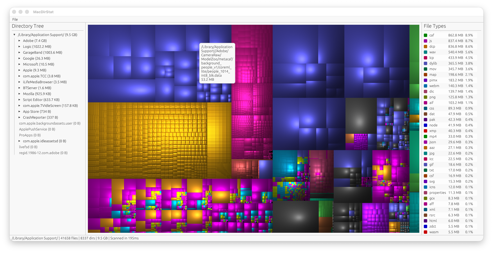

# MacDirStat

A disk usage visualizer for macOS, inspired by [WinDirStat](https://windirstat.net/) and [WizTree](https://diskanalyzer.com/). I loved the functionality of these tools but was never really satisfied with the alternatives available on macOS, so I built my own.

## Features

- **Treemap visualization** with cushion shading (matching WinDirStat's look)
- **Directory tree** with collapsible nodes, keyboard navigation, and size annotations
- **File type breakdown** showing extension statistics with color coding
- **Fast scanning** using macOS-native `getattrlistbulk` syscall with parallel tree building via rayon
- **Non-blocking scans with progress** — scanning runs in the background, showing a percentage, file/folder counts and size as it goes; it can be cancelled at any time
- **Instant results from cache** — every scan is cached (`~/Library/Caches/macdirstat`); reopening a folder shows the previous result immediately while it is refreshed in the background (the cache of a scanned parent folder is used too). ⌘R rescans
- **Skips virtual and duplicate volumes** — mount points hidden from Finder (system volumes, simulator runtimes, FSKit mounts like `~/Library/Developer/CoreDevice/DeviceFS`) and non-local mounts aren't traversed; scanning `/` also skips `/Volumes`
- **Delete files/folders** directly from the UI — ⌘Delete for instant delete, Delete for native macOS confirmation dialog
- **Open any folder** via the File menu, native folder picker on startup, or pass a path on the command line

## Screenshot



## Building

Requires Rust (2024 edition). macOS only — uses platform-specific APIs for fast directory scanning.

```sh
cargo build --release
# or build an .app bundle into target/release/MacDirStat.app
./scripts/make_app.sh
```

Benchmark the scanner (and cache round-trip) on a folder:

```sh
cargo run --release --example bench_scan -- /path/to/scan 3
```

## Usage

```sh
# Launch with folder picker
cargo run --release

# Scan a specific directory
cargo run --release -- /path/to/scan
```

## How it works

MacDirStat scans directories using the macOS `getattrlistbulk` syscall, which retrieves multiple directory entries with their attributes in a single kernel call — avoiding per-file overhead. Directory traversal is parallelized across cores using rayon, with `openat()` for efficient relative path resolution.

Scans run on a background thread and report progress through atomic counters. When the folder (or a parent) was scanned before, the percentage is based on the previous file/folder count; otherwise it is estimated by giving every directory a share of the total, split among its subdirectories by their entry counts. Completed scans are stored as an LZ4-compressed pre-order encoding of the tree — for a full-disk scan of ~3M files that is ~45 MB and loads in ~250 ms.

The treemap uses squarified layout from the `treemap` crate with cushion-shaded rendering, producing the familiar WinDirStat look where each file is a colored rectangle sized proportionally to its disk usage.

## License

[GPL-3.0](LICENSE)
